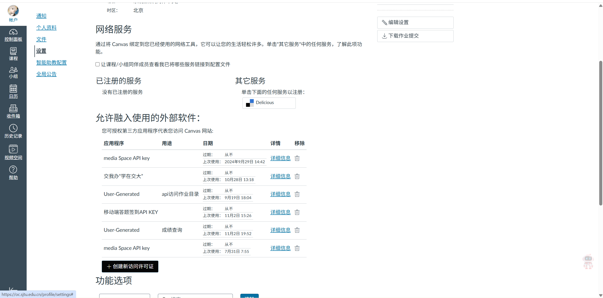

# Canvas 学习助手：从零开始

这是不依赖 AI Agent 的本机网页工具。默认显示独立作业进度页，逾期未交用红色区块优先列出，待提交用黄色强调；资料下载在另一页。

## 第一次使用：只做一次

1. 把分享 ZIP 解压到自己喜欢的位置，打开 `canvas-manager` 文件夹。不要在压缩包预览窗口中直接运行。
2. 准备 Python **3.11+**、`requests` 和系统 `curl`。已有 Python 的同学可以复用自己的环境。程序不自动安装、升级或修改环境。
3. Windows 双击 `start_canvas.cmd`。macOS / Linux 打开终端，在解压目录运行 `python3 run_canvas.py`。浏览器会打开本机 `127.0.0.1:8765`；关闭网页不会终止程序，在终端按 Ctrl+C 停止。
4. 首次运行进入「账号与新学期配置向导」。依次阅读准备事项、填写账号、选择学期和整理规则、核对预览并保存。

### 没准备好 Python？

可以从 [Python 官方下载页](https://www.python.org/downloads/) 安装 Python 3.11 或更高版本。Windows 安装时启用 Python Launcher，或按安装器提示加入 PATH。若学校已提供 Conda，请按学校说明创建/选择环境，不必重复安装 Python。

检查自己的 Python 路径和依赖，再决定是否安装：

```powershell
python --version
python -c "import sys; print(sys.executable)"
python -c "import requests; print(requests.__version__)"
curl --version
```

确实缺少 requests 时，在你选定的 Python 环境中运行：

```powershell
python -m pip install -r requirements.txt
```

源码仓库内对应文件名为 `requirements-canvas.txt`。macOS / Linux 可将 `python` 替换为自己的 `python3`。该步骤由你主动执行，程序不会自行安装。若有多个 Python，使用完整解释器路径；Windows 也可设置环境变量 `CANVAS_PYTHON` 为自己的 Python 可执行文件。

> 真机截图待补：解压分享包、Windows 启动窗口、选择 Python 环境。

## Token 怎么获取？

在学校 Canvas 中打开「账户 → 设置」，向下滚动到「允许融入使用的外部软件」，点击列表下方的 **「＋创建新访问许可证」**，填写用途并完成创建，再复制 Token。交大默认网站地址为 `https://oc.sjtu.edu.cn`；其他学校改填自己的 HTTPS Canvas 根地址。学校如禁用个人令牌，需要联系学校支持。

向导中的账号名仅用于本机区分，例如 `student-a`，不需要填写学号或密码。输入 Token 后可点「测试连接并读取课程」，随后勾选本学期课程。已有账号的 Token 不会回显，留空表示保留；换网站时需重新填写对应 Token。



图中左侧为「账户 → 设置」，左下方按钮为「＋创建新访问许可证」。此图展示创建入口，没有展示实际 Token。

> 下一张真机截图待补：填写用途、创建许可证及复制 Token（截图须遮住完整令牌）。

配置字段参考了 [sjtu-canvas 配置说明](https://github.com/xhh678876/sjtu-canvas#%EF%B8%8F-%E9%85%8D%E7%BD%AE)：Token、学校网站、资料保存位置。本工具的网页版本无需 OpenClaw，也无需课件提取和 Office 处理依赖。

## 学期与整理规则

已有资料库：填写原来的绝对路径，**不勾选初始化**。不移动或重命名已有文件。

新学期：填写一个尚不存在的新文件夹路径，例如 `D:\学习资料\2027春季` 或 `/Users/me/Courses/2027Spring`，可选勾选初始化。应用名称、学期名称、作业/资料页名称，以及课件、作业、项目、参考、附件、代码、周目录前缀均可更改。

在预览页检查完整路径清单后勾选确认，才创建新目录。课程目录来自测试连接后自动生成的「课程目录映射」；可在高级设置中改成自己习惯的目录名。未读取课程时可以只初始化空学期资料库，课程目录会在下载时建立。初始化产生的 `semester.json` 仅记录目录和页面设置，没有 Token。资料库根目录若已存在会拒绝初始化，可取消初始化后复用。

> 真机截图待补：学期设置、课程勾选、自定义目录、初始化预览。

## 平时怎么用？

- 作业页：点击刷新，从 Canvas 读取实际提交状态，优先处理红色逾期区和黄色待交区。已提交、已评分作业折叠显示；未知状态需要进入 Canvas 核对。
- 资料页：扫描、筛选、勾选下载。旧文件递归识别，新文件用索引和 SHA-256 去重。同名冲突保留原文件；文件先写临时文件并校验大小，再无覆盖发布。
- 新学期/另一账号：打开「账号与学期设置」，选择/新建账号，修改学期、课程范围、位置和命名后保存，再刷新。不同账号分别保留整理设置；同一账号换学期时旧资料留在原位置，但该账号当前配置切换到新学期。
- 实际提交作业：使用卡片中的 Canvas 链接，核对并在 Canvas 完成。本工具没有自动上传/提交接口。

历史无索引文件只能按名称和大小判断，页面会标明未核验远端内容；新下载才有本地校验索引。无法可靠判断教学周的文件保留在课件顶层，不猜测日期周次。

## 配置在哪里？如何分享？

首次使用默认保存到当前系统用户目录的 `.canvas-manager/config.json`，例如 Windows 的 `C:\Users\你的用户名\.canvas-manager\config.json`。兼容旧安装：若用户配置尚不存在且源码目录已有 `config.json`，继续使用旧配置。

Token 只写入该个人配置，不通过 GET 接口回显、不写入学期资料库、不打入分享包。同一电脑若有不同同学使用，优先采用不同系统用户；也可各自用 `--config` 指定独立个人配置。

```powershell
python run_canvas.py --config "D:\个人配置\canvas-a.json"
python run_canvas.py --port 8766
python run_canvas.py scan
python run_canvas.py scan --all-courses
```

只分享原始发布 ZIP，不要打包个人配置或资料库。网页仅监听本机回环地址；此版本不是可公开部署的多用户服务器。同一电脑上的其他进程仍受操作系统用户权限约束；Token 文件应保存在你自己可访问的位置。

高级用户可参考 `canvas-manager.example.json` 的脱敏结构。优先使用向导，不要把示例占位 Token 当成有效配置。CLI 参数覆盖当次运行的设置；向导保存后切换至刚保存的设置。

## 常见问题

- 连不上：先在浏览器访问 Canvas，确认校园网/VPN、网站地址和 Token。网络失败会停止，不当作无作业。
- 401/403：Token 可能过期或没有权限；403 也可能只是某门课的文件不可访问，检查页面错误清单。
- 目录已存在：取消初始化以复用，或选择新的学期位置。程序不会替你清理旧目录。
- 没课程：检查是否勾选了课程限制；历史课程可启用「包括历史课程」。文件夹初始化不需要下载课程文件。
- 端口占用：关闭旧终端，或使用 `--port 8766`。
- 下载锁残留：确认没有下载进程后手动移除目标资料库 `.canvas-state/download.lock`。
- 文件系统不支持硬链接：本版本需要支持硬链接的本地文件系统（例如 NTFS）；不支持时会保留原文件并报错。

## 验证

```powershell
python -B -m unittest discover -s tests -p "test_canvas_manager*.py" -v
```

测试使用临时目录和模拟 Canvas，不需要 Token。自动化测试通过不代表已在所有操作系统真机验收；当前 Windows 的运行环境和真实 Canvas 检查见项目验收记录。
