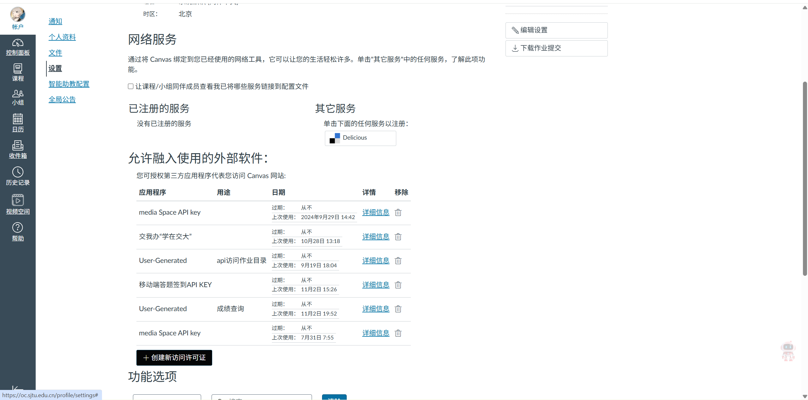

# Canvas Assistant UI

无需 AI Agent 的本机 Canvas 网页助手：优先检查作业提交进度，按自己的目录规则下载课程资料。

- **作业专页**：红色突出逾期未交、黄色提示待提交，已交与已评分可折叠查看，提供 Canvas 提交页面链接。
- **自选下载**：按课程、类型和下载状态筛选，查看后台进度；递归查找旧文件，以索引和 SHA-256 校验新下载。
- **新学期向导**：配置自己的 Token、学校地址、课程范围、保存位置、目录与页面名称；可选初始化新资料库。
- **文件保护**：校验后原子无覆盖落盘，同名冲突保留原件，不自动迁移或删除既有文件。

## 下载与启动

在 [Releases](https://github.com/Totheinfinity66y/canvas-assistant-UI/releases) 下载最新版 ZIP 并解压。需要 Python **3.11+**、requests 和系统 curl。

Windows 可双击 `start_canvas.cmd`；macOS / Linux 在解压目录运行：

```sh
python3 run_canvas.py
```

已有 Python 环境中缺少依赖时，可自行运行：

```sh
python -m pip install -r requirements.txt
```

程序不自动安装依赖。首次启动会进入配置向导；默认只在本机 `127.0.0.1:8765` 提供网页。在终端按 Ctrl+C 停止服务。

## Canvas Token 获取入口

打开 Canvas「账户 → 设置」，滚动到「允许融入使用的外部软件」，点击列表下方的「＋创建新访问许可证」。创建后把 Token 填入本机向导；不要公开完整令牌。



详细步骤、账号切换、新学期初始化与常见问题见 [使用指南](GETTING_STARTED.md)。

## 验证

```sh
python -B -m unittest discover -s tests -p "test_canvas_manager*.py" -v
node --test tests/test_canvas_frontend.cjs
```

Python 测试不需要 Token；Node 仅用于前端逻辑测试，不是运行网页的依赖。当前已在 Windows 验证，macOS / Linux 入口已适配，真机兼容性仍待验证。

## 数据与范围

配置文件保留在自己的系统用户目录或 `--config` 指定位置；仓库和发布包不包含真实凭证、个人课件、下载索引。复用已有目录不会迁移文件；初始化只接受新的根目录并要求预览确认。

本工具读取作业提交进度，实际上传/提交在 Canvas 页面完成。它是本机工具，不是面向公网的多用户服务器。

## 来源与许可

本工具从 [openclaw-sjtu](https://github.com/xhh678876/openclaw-sjtu) 的本地独立网页管理器整理而来，配置方式参考 [sjtu-canvas](https://github.com/xhh678876/sjtu-canvas)。保留原项目 [MIT 许可证](LICENSE)。截图由项目使用者提供。
